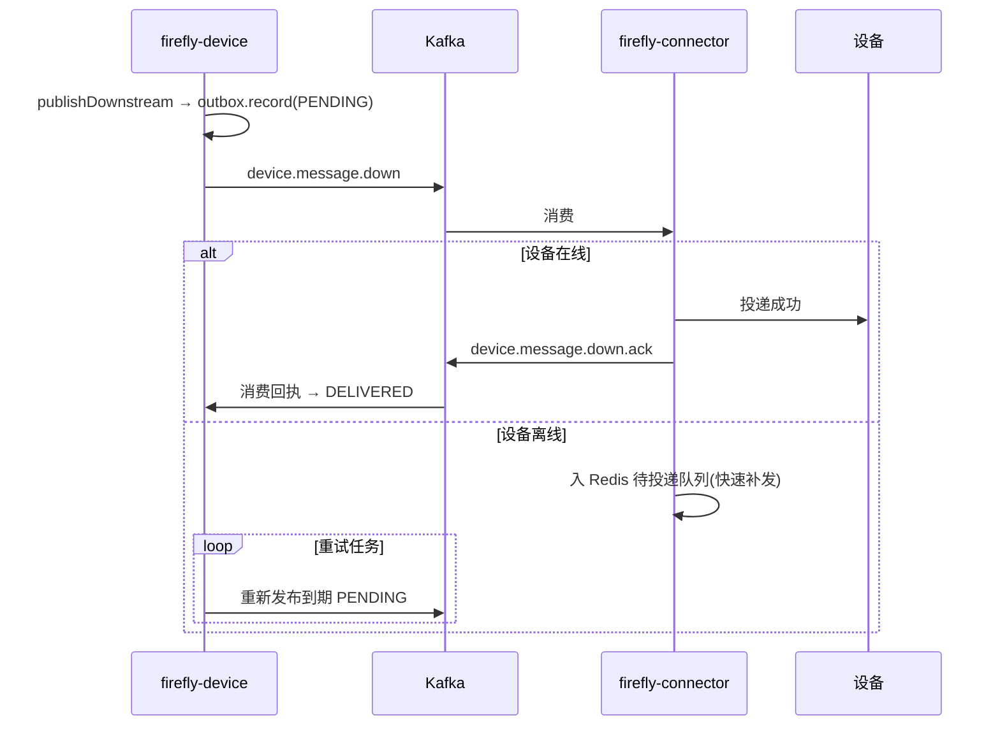

# 下行消息持久化投递（Outbox）设计说明

## 1. 背景与目标

下行链路此前只有 Kafka（device → connector）+ connector 内 Redis 待投递队列：Redis 使用 `allkeys-lru` 且无 AOF，connector 重启或 Redis 数据丢失时会丢离线设备的下行指令（审计 P1-13「下行离线即丢」）。

本次补齐持久化 outbox：

1. 下行指令发布到 Kafka 前先落 PostgreSQL（`downlink_outbox`，权威来源）。
2. connector 投递成功回执（`device.message.down.ack`）→ outbox 标记 DELIVERED。
3. 未回执的 PENDING 记录由重试任务按指数退避重新发布，直到 DELIVERED 或 FAILED。

## 2. 架构与流程

- **权威来源**：`downlink_outbox` 是唯一持久化来源；connector 的 Redis 待投递队列保留为「重连快速补发」优化，不再是唯一可靠性保障。
- **至少一次**：设备按 `message_id` 幂等去重，允许重试与快速补发叠加产生重复投递。

## 3. 数据模型

`downlink_outbox`（firefly-device Flyway `V36`）：

| 字段 | 类型 | 说明 |
| --- | --- | --- |
| `device_id` + `message_id` | BIGINT + VARCHAR | 唯一约束，幂等落库 |
| `payload` | TEXT | 序列化的完整 DeviceMessage |
| `status` | VARCHAR | PENDING / DELIVERED / FAILED |
| `attempts` / `max_attempts` | INT | 重试计数与上限 |
| `next_retry_at` | TIMESTAMPTZ | 下次重试时间（退避） |
| `last_error` | VARCHAR | 最近一次失败原因 |

## 4. 组件

- `DownlinkOutboxService`（device）：`record` 幂等落库、`markDelivered`、`retryDue` 重发 + 退避 + 置 FAILED。
- `DownlinkOutboxRetryJob`（device）：`@Scheduled` + Redis 分布式锁，多实例只一台重发。
- `DownlinkAckConsumer`（device）：消费 `device.message.down.ack` 回执。
- connector `DeviceMessageProducer.publishDownlinkAck` + `MqttDownstreamConsumer`/`DownlinkPendingFlusher` 投递成功后回执。

## 5. 配置

| 配置 | 默认 | 说明 |
| --- | --- | --- |
| `firefly.downlink.outbox.max-attempts` | `5` | 最大重试次数 |
| `firefly.downlink.outbox.retry-base-seconds` | `30` | 退避基数（指数增长，封顶 6h） |
| `firefly.downlink.outbox.retry-batch-size` | `200` | 每轮重发条数 |
| `firefly.downlink.outbox.retry-interval-ms` | `10000` | 重试任务轮询间隔 |

## 6. 风险与限制

1. 至少一次语义，需设备按 `message_id` 幂等；重复投递不保证业务副作用只执行一次。
2. FAILED 记录保留在表内，需运维介入或后续补「失败重投工具」。
3. connector 仍保留 Redis 待投递队列，重连补发与 outbox 重发可能叠加，靠设备幂等兜底。
