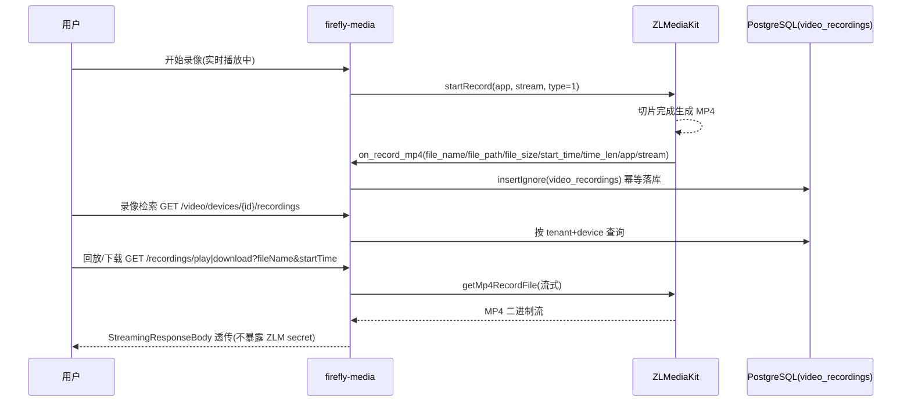

# 视频历史回放、录像检索与录像下载设计说明

## 1. 背景与目标

`firefly-media` 此前只支持实时点播、PTZ、截图与「开始/停止录像」开关，缺少录像检索、历史回放与录像下载（审计 P2-04）。本次补齐：

1. 录像检索：按设备查询已录制的 MP4 元数据。
2. 历史回放：浏览器内播放已录制的 MP4 文件。
3. 录像下载：下载已录制的 MP4 文件。
4. 录像元数据由 ZLMediaKit `on_record_mp4` webhook 幂等写入，不依赖前端轮询 ZLM。

## 2. 范围

- 范围内：ZLMediaKit 录制的 MP4 的元数据落库、检索、流式回放与下载；ZLM hook 配置自动接线。
- 范围外（已知限制）：
  - GB28181 原生「历史回放 INVITE」（设备端按时间范围推送历史码流）不在本次范围，本次回放针对平台录制（ZLM 本地 MP4）文件。
  - 录像文件清理/保留策略仍由 ZLM 的 `record.fileSecond` 切片与磁盘策略负责，平台不单独清理 ZLM 磁盘文件。
  - 回放暂不支持 Range 断点/拖拽定位（ZLM `getMp4RecordFile` 为整文件流式返回），线性播放可用。

## 3. 架构与流程

### 3.1 数据流

### 3.2 设备归属解析

ZLM 回调里的 `stream` 由平台 `VideoService.buildStreamId` 生成，格式为 `{tenantId}_{deviceId}_{channelId}`；`on_record_mp4` 据此恢复录像归属（`tenantId`、`deviceId`、`channelId`），避免依赖可能已关闭的 `stream_sessions`。无法解析（非平台管理的流，如本地摄像头 `simcam-*` 因 `enable_mp4=false` 不会触发）时直接忽略。

## 4. 数据模型

`video_recordings`（Flyway `V8__add_video_recordings.sql`）：

| 字段 | 类型 | 说明 |
| --- | --- | --- |
| `tenant_id` / `device_id` | BIGINT | 录像归属 |
| `channel_id` | VARCHAR | 通道编号（可空） |
| `app` / `stream` | VARCHAR | ZLM 录制流标识 |
| `file_name` / `file_path` | VARCHAR | 文件名与 ZLM 磁盘绝对路径 |
| `file_size` | BIGINT | 字节数 |
| `start_time` | BIGINT | 录像开始时间（epoch 毫秒，避免 TIMESTAMPTZ 时区歧义） |
| `duration_seconds` | DOUBLE | 时长（秒） |

- `uk_video_recordings_file_path`：`file_path` 唯一，webhook 重试幂等。
- `idx_video_recordings_device_time`：检索索引。

## 5. 接口

| 方法 | 路径 | 权限 | 说明 |
| --- | --- | --- | --- |
| GET | `/api/v1/video/devices/{deviceId}/recordings` | `video:read` | 录像检索（返回 `fileName/fileSize/startTime/durationSeconds/channelId`，不含 DB 主键与 ZLM 绝对路径） |
| GET | `/api/v1/video/devices/{deviceId}/recordings/play?fileName=&startTime=` | `video:record` | 历史回放（`video/mp4` 流式） |
| GET | `/api/v1/video/devices/{deviceId}/recordings/download?fileName=&startTime=` | `video:record` | 录像下载（`application/octet-stream`，attachment） |

回放/下载用「`fileName` + `startTime`（epoch 毫秒）」作为业务键定位，天然按 `tenant + device + fileName + startTime` 完成越权校验。

## 6. 关键设计取舍

- **`start_time` 用 epoch 毫秒存 BIGINT**：避免 `TIMESTAMPTZ` ↔ `LocalDateTime` 在 JDBC 层往返引入的时区偏移，也让回放/下载的业务键可以直接取整数值。
- **流式代理不落盘**：回放/下载通过 `StreamingResponseBody` + `HttpResponse.BodyHandlers.ofInputStream()` 透传 ZLM 文件，不整体载入内存、不复制到 MinIO，也不把 ZLM `secret` 暴露给前端。
- **幂等落库**：`insertIgnore` 使用 `ON CONFLICT (file_path) DO NOTHING`，而非 check-then-insert，规避并发/重试重复记录（对齐审计 P1-15 的幂等口径）。

## 7. 风险与限制

1. 回放/下载依赖 ZLM 磁盘文件仍在；ZLM 清理策略过激进会导致元数据存在但文件 404。
2. 多实例 `firefly-media` 时，ZLM `on_record_mp4` 回调指向任意一个实例均可（元数据共享 DB）。
3. ZLM hook 需要能访问 `firefly-media:9040`（Compose 内网），部署脚本已自动写 `on_record_mp4` 地址。
